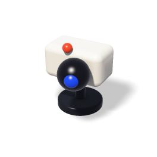

  <picture>
    <source media="(prefers-color-scheme: dark)" srcset="assets/hero-dark.png">
    
  </picture>

  I build useful software with AI coding agents,
  and I like finding out what they can really do.

 

### Shipped and public

<picture>
  <source media="(max-width: 600px) and (prefers-color-scheme: dark)" srcset="assets/translate-dark.png 7x">
  <source media="(max-width: 600px)" srcset="assets/translate-light.png 7x">
  <source media="(prefers-color-scheme: dark)" srcset="assets/translate-dark.png 3x">
  <source srcset="assets/translate-light.png 3x">
  
</picture>

**[SmartAITranslator](https://apps.apple.com/us/app/smartaitranslator/id6757966733)** · iPhone app, on the App Store 
One input, several AI models translating side by side.

 

### In the workshop

Not public yet.

<picture>
  <source media="(max-width: 600px) and (prefers-color-scheme: dark)" srcset="assets/watch-dark.png 7x">
  <source media="(max-width: 600px)" srcset="assets/watch-light.png 7x">
  <source media="(prefers-color-scheme: dark)" srcset="assets/watch-dark.png 3x">
  <source srcset="assets/watch-light.png 3x">
  
</picture>

**WristType** · Apple Watch, iPhone and Mac 
All-day recording from the wrist, transcribed and analysed by AI.

 

<picture>
  <source media="(max-width: 600px) and (prefers-color-scheme: dark)" srcset="assets/subtitle-dark.png 7x">
  <source media="(max-width: 600px)" srcset="assets/subtitle-light.png 7x">
  <source media="(prefers-color-scheme: dark)" srcset="assets/subtitle-dark.png 3x">
  <source srcset="assets/subtitle-light.png 3x">
  
</picture>

**SubtitleStudio** · Mac app with an iPhone remote 
Transcribes online or local video and adds subtitles in another language, all on-device.

 

<picture>
  <source media="(max-width: 600px) and (prefers-color-scheme: dark)" srcset="assets/camera-dark.png 7x">
  <source media="(max-width: 600px)" srcset="assets/camera-light.png 7x">
  <source media="(prefers-color-scheme: dark)" srcset="assets/camera-dark.png 3x">
  <source srcset="assets/camera-light.png 3x">
  
</picture>

**Camera Hub** · home CCTV, Mac and ESP32 
Smart CCTV: live camera streams with motion and object detection, and alerts.

 

### How I work with agents

About twenty projects sit on one short set of written principles. A lesson learned in one project goes into the
shared notes, so the next project starts with it.

  <picture>
    <source media="(prefers-color-scheme: dark)" srcset="assets/foundation-dark.png">
    
  </picture>

- **Measure, don't guess.** Get a number before changing anything: a frame count, a test score, a timing.
- **Test under real conditions.** Real data, real speech, real taps. Clean examples lie.
- **Say what was proven and what was not.**
- **Looks and feel come first.** Nothing should look machine-made.
- **State lives in files any agent can read,** so Claude Code or Codex can pick up where the other stopped.
- **Keep it light.** The lightest process that works.

### Lately

Swift · Python · JavaScript · Claude Code · Codex · local models

 

  <a href="https://www.linkedin.com/in/huayu-qin-06132a20a/">LinkedIn</a>

  The 3D pictures on this page are rendered by a small ray marcher in <a href="tools">tools/</a>. No 3D software was used.

